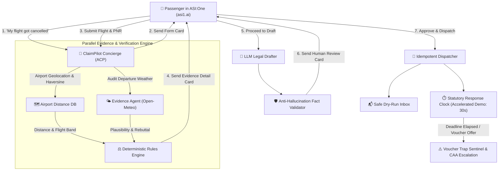

# ✈️ ClaimPilot: Autonomous Flight Disruption Sentinel
> **ASI:One Agent Challenge – From Intent to Action (Fetch-A-Thon 3.0)**  
> *Transforming passenger frustration into statutory cash compensation entirely inside ASI:One.*

[](https://opensource.org/licenses/MIT)
[](https://agentverse.ai/)
[](https://eur-lex.europa.eu/)
[](https://asi1.ai/)

---

## 🎯 Executive Summary
Most AI travel assistants stop at providing general advice. When an airline cancels a flight, passengers are subjected to opaque customer support, bad-weather excuses, and coercive "travel vouchers" designed to evade statutory cash liabilities.

**ClaimPilot turns intent into legally binding action.** It operates entirely inside an **ASI:One** conversation using the **Agent Chat Protocol (ACP)** and **ASI Interactive Cards**. It cross-examines airline excuses against independent meteorological reanalysis (Open-Meteo), executes a deterministic rules engine (EU261 & DGCA India), drafts an audit-proof legal notice, enforces a **Human-in-the-Loop Review Gate**, dispatches the claim with idempotency guards, and neutralizes airline "voucher traps".

---

## 👥 Target Users & Problem Solved
* **Target Users**: Airline passengers facing flight cancellations, denied boarding, or severe delays (> 3 hours) in European or Indian airspace.
* **The Problem**: Over €5 billion in legitimate passenger compensation goes unclaimed annually because airlines make claiming tedious, hide passenger rights, or offer expiring flight vouchers instead of cash.
* **The Outcome Produced**: A fully audited, legally validated Statutory Notice of Claim delivered directly to the airline relations department with an automated 14-day statutory response clock and voucher counter-action.

---

## 🛠️ System Architecture & Workflow



---

## 🌟 What Sets ClaimPilot Apart

### 1. Zero-Hallucination Guarantee (Deterministic Code over LLM)
Unlike generic chatbots that hallucinate legal articles or make up compensation figures:
* **The LLM is restricted to only 3 jobs**: extracting intake, stylistic drafting, and classifying airline replies.
* **All legal decisions are 100% deterministic code**: versioned rules JSON files for **EU261** (`rules/eu261.json`) and **DGCA India** (`rules/dgca.json`).
* **Post-Draft AST Validator (`engine/drafter.py`)**: Rejects any draft where amounts, dates, or legal citations differ from the deterministic facts object.

### 2. Full Suite of ASI:One Interactive Cards
ClaimPilot uses all **4 predefined ASI:One card kinds** using official `uagents-core` schemas:
1. **Form Card (`form`)**: Structured intake for flight number, PNR, date, notice window, and carrier's stated excuse.
2. **Carousel Card (`carousel`)**: Multi-leg route disambiguation and carrier selection.
3. **Detail Card (`detail`)**: Evidence breakdown, statutory entitlement, Open-Meteo weather audit, and claim strength score (0-100).
4. **Review Card (`review`)**: Human approval gate requiring explicit passenger consent before dispatch.
5. **Voucher Trap Review Card (`review`)**: Immediate statutory counter-offer when airlines offer restrictive vouchers.

### 3. Open-Meteo Meteorological Reanalysis (CC BY 4.0)
Airlines routinely claim "unforeseen adverse weather" to avoid paying cash. ClaimPilot queries Open-Meteo for the departure airport's hourly wind gusts, visibility, precipitation, and WMO codes, scoring the excuse:
* **LOW Plausibility**: Benign operational conditions (e.g., gusts < 35 km/h, visibility > 8 km) → Rebuttal paragraph embedded in the notice.
* **HIGH Plausibility**: Severe conditions detected → Informs the passenger that the carrier may have an extraordinary circumstances defense.

### 4. Transparent Claim Strength Meter
Computes an objective 0–100 score based on statutory criteria, weather evidence, and European Court of Justice (ECJ) precedent (*C-402/07 Sturgeon*, *C-549/07 Wallentin-Hermann*).

### 5. Accelerated Clock & Safe Dry-Run Dispatch
* **Accelerated Clock**: In demo mode (`DEMO_MODE=True`), the 14-day statutory deadline elapses in **30 seconds**, allowing judges to see the automated escalation and voucher trap handling live.
* **Safe Dry-Run Dispatch**: Directs claim emails to a configured test inbox (`passenger.claimpilot@gmail.com`) so no real airline is inadvertently messaged during hackathon evaluations.

---

## 💰 Monetization & Payment Protocol (Bonus Criterion)
ClaimPilot implements a **No-Win, No-Fee Success Protocol**:
1. **Free Initial Audit**: Intake, weather verification, and detail cards are 100% free.
2. **Success Settlement Fee**: When a claim is paid out by an airline, a 15% success fee is settled via the Fetch.ai / ASI micropayment protocol using testnet FET/ASI tokens.
3. **Commercial Production Note**: While Open-Meteo's free tier is utilized for this hackathon under CC BY 4.0 attribution, production deployments will transition to an Open-Meteo Commercial API subscription.

---

## 🚀 Quickstart & Testing

### 1. Prerequisites
* Python 3.10 or 3.11
* Google AI Studio API key (or ASI:One API key)
* Agentverse account at [agentverse.ai](https://agentverse.ai/)

### 2. Installation
```bash
git clone https://github.com/your-username/claimpilot.git
cd claimpilot

# Create virtual environment
python -m venv .venv
source .venv/bin/activate  # On Windows: .\.venv\Scripts\activate

# Install dependencies
pip install -r requirements.txt
```

### 3. Configure Environment
Copy `.env.example` to `.env`:
```bash
cp .env.example .env
```
Add your `GEMINI_API_KEY` (or `ASI1_API_KEY`) and optional `AGENTVERSE_MAILBOX_KEY`.

### 4. Run Golden Unit Tests
Verify that statutory compensation tiers for EU261 (€250, €400, €600) and DGCA (₹5,000, ₹7,500, ₹10,000) pass deterministically:
```bash
python -m pytest -v tests/test_golden.py
```

### 5. Run Local Walkthrough Simulation
To see the entire 7-step pipeline execute end-to-end in the terminal:
```bash
python demo_walkthrough.py
```

### 6. Run Live Agent with Agentverse Mailbox
Connect your agent to **Agentverse** and **ASI:One**:
```bash
python -m agents.concierge
```
Your agent will connect to your Agentverse mailbox and listen for chat messages directly from [ASI:One](https://asi1.ai/)!

---

## 🧪 Testing in the ASI:One Card Playground
All 4 card payloads are exported in `cards/playground_samples/`. You can test rendering them immediately in the [ASI:One Card Playground](https://asi1.ai/developer/card-playground):
* `1_intake_form.json`
* `2_flight_carousel.json`
* `3_evidence_detail.json`
* `4_human_review.json`
* `5_voucher_trap_review.json`

---

## 🏷️ Discovery Keywords & Metadata
* **Agent Name**: `ClaimPilot Flight Disruption Sentinel`
* **Agentverse Tags**: `Travel`, `Legal`, `Flight Cancellation`, `EU261`, `DGCA`, `Refund`, `Automation`, `Interactive Cards`
* **Discovery Description**: *Autonomous legal sentinel for flight cancellations and delays. Deterministically verifies statutory cash compensation under EU261 & DGCA, audits weather evidence with Open-Meteo, and dispatches audited claims.*

---

## ⚖️ Legal Disclaimer
*ClaimPilot provides factual statutory guidance and automated administrative claim preparation based on publicly enacted civil aviation regulations. It does not provide formal legal advice or attorney representation.*
